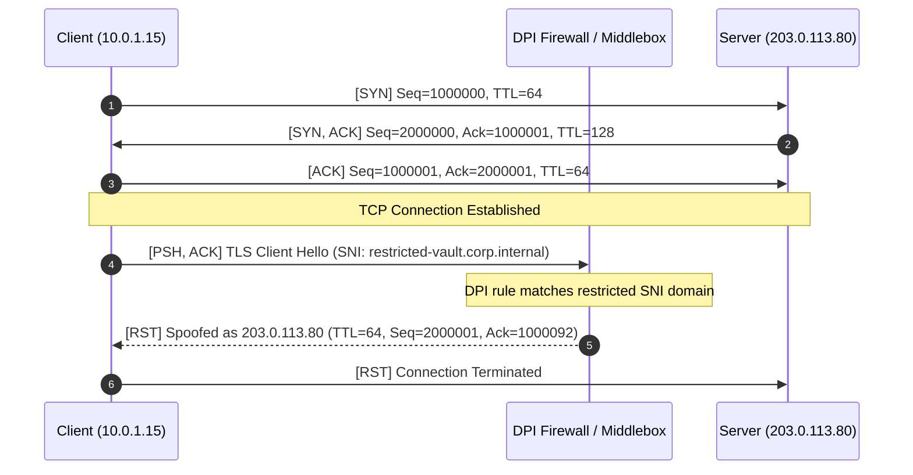

# Incident Report: Middlebox TCP Reset Injection via DPI SNI Inspection

## Root Cause Statement
During the establishment of a TLS session between client `10.0.1.15` and server `203.0.113.80:443`, the client transmitted a TLS Client Hello containing the Server Name Indication (SNI) `restricted-vault.corp.internal`. Immediately following this packet, an in-path middlebox/DPI firewall detected the policy violation and injected a spoofed TCP RST packet towards the client masquerading as the server (`203.0.113.80`). This out-of-band injection was conclusively proven by the anomalous IP Time-To-Live (TTL=64), whereas legitimate packets from `203.0.113.80` have TTL=128.

## Reconstructed Packet Flow



## Recommended Remediation

### 1. DPI Firewall / Security Gateway Policy Adjustment
Update the DPI / Next-Generation Firewall (NGFW) policy to whitelist the legitimate corporate vault FQDN:

```bash
# Allow TLS traffic directed to restricted-vault.corp.internal for authorized subnet
firewall-cmd --permanent --zone=internal --add-rich-rule='rule family="ipv4" source address="10.0.1.0/24" destination address="203.0.113.80" service name="https" accept'
firewall-cmd --reload
```

### 2. nftables / iptables DPI Bypass (Linux Edge Gateway)
If edge routing with nftables is performing stateful content filtering, explicitly bypass DPI inspection for the destination endpoint:

```bash
# Add bypass rule in nftables prior to DPI inspection hook
nft insert rule inet filter forward ip saddr 10.0.1.15 ip daddr 203.0.113.80 tcp dport 443 counter accept
```

### 3. Alternative Architectural Mitigation: Encrypted Client Hello (ECH)
Deploy Encrypted Client Hello (ECH) across client endpoints to prevent intermediate middleboxes from reading plaintext SNI headers.
