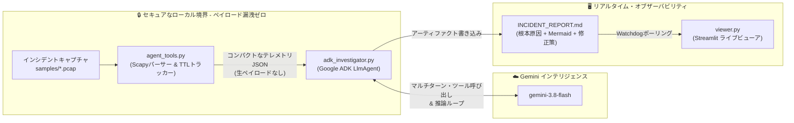

# 🕵️ 自律型SREネットワーク調査エージェント (Powered by Google ADK)

> **Google ADK (`google-adk`)、Gemini 3.8 Flash、および Scapy を活用した、自律的かつプライバシーファーストなネットワークインシデント診断システム。**

疑わしいパケットキャプチャ（`.pcap`）を自律的に検査し、ワイヤレベルの異常（偽装されたTCPリセットやTTLの不一致など）を検出し、インタラクティブな Mermaid.js シーケンス図を再構築し、実行可能なファイアウォール緩和ポリシーをリアルタイムで生成する、AI駆動のサイトリライアビリティエンジニアリング（SRE）エージェントです。

---

## 🌟 ハッカソン・エレベーターピッチ（30秒）

> *「本番環境の接続が謎の切断を起こしたとき、ネットワークエンジニアは何千ものWiresharkパケットを何時間もかけて調査します。パケットキャプチャのアップロードはセキュリティコンプライアンスに違反し、生のPCAPはコンテキスト長の上限を超えてしまうため、従来のLLMでは対応できませんでした。*
>
> *そこで私たちは、**Google ADK** と **Gemini 3.8 Flash** を用いて **自律型SREネットワーク調査エージェント（Autonomous SRE Network Investigator）** を構築しました。生のパケットペイロードを厳密にローカル環境内に留めたまま、Scapyで決定論的なワイヤテレメトリを計算し、微細な異常（中間ホップのTTL不一致など）を自律的に推論して、再構築されたMermaidシーケンス図を含む実用的なインシデントトリアージレポートをリアルタイムのStreamlitダッシュボードへライブ配信します。」*

---

## 🏛️ システムアーキテクチャ



### コア設計原則
1. **ゼロトラスト・プライバシー境界**: 生のパケットペイロードは決してLLMに送信されません。集約されたフローメタデータ（5タプル、フラグカウント、TTL統計、フラグ付けされたSNIドメイン文字列）のみがやり取りされます。
2. **決定論的なグラウンドトゥルース（根拠データ）**: エージェントが推論を行う前に、Scapyが事実（TTL分布、RSTフラグ、重複ACK）を計算するため、テレメトリのハルシネーション（幻覚）を防止します。
3. **Google ADK コードファースト・エージェント**: `google-adk` の `LlmAgent` と `Runner` によるネイティブなマルチターン・ツール呼び出しにより、調査ワークフローを自律的にオーケストレーションします。
4. **ライブ・アーティファクト・ウォッチャー**: Streamlitがリアルタイムポーリングによってエージェントのファイルシステム出力を監視し、エージェントが推論を終えた瞬間にインタラクティブなMermaid図を更新してオーディエンスに表示します。

---

## 📂 リポジトリ構成

```
~/VIRTUAL/pcap-demo/
├── adk_investigator.py       # Google ADK エージェント (LlmAgent + pcap_tool バインディング)
├── agent_tools.py           # Scapy パケットパーサー、TTL分析、TLS SNI 抽出ツール
├── viewer.py                # Mermaidレンダリング対応の Streamlit リアルタイム・インシデントダッシュボード
├── INCIDENT_REPORT.md       # エージェントが生成したインシデントレポート (ライブアーティファクト)
├── samples/                 # サンプルのインシデントPCAPファイル
│   └── 03_firewall_rst_injection.pcap # DPIファイアウォールによるRSTインジェクション事例
├── data/                    # ローカルPCAP専用ディレクトリ (git-ignored)
├── .env                     # GEMINI_API_KEY 設定ファイル
├── requirements.txt         # プロジェクトの依存パッケージ
├── README.md                # ハッカソンプレゼンテーション＆セットアップガイド（英語版）
└── README_ja.md             # ハッカソンプレゼンテーション＆セットアップガイド（日本語版）
```

---

## ⚡ クイックスタート＆セットアップ

### 1. 前提条件
- macOS / Linux
- Python 3.14 (または Python 3.10以上)
- [uv](https://github.com/astral-sh/uv) (推奨) または標準の `pip`

### 2. インストール
```bash
cd ~/VIRTUAL/pcap-demo

# 必要に応じて仮想環境を作成
uv venv --python 3.14
source bin/activate

# 依存パッケージのインストール
uv pip install google-adk google-genai streamlit scapy python-dotenv pydantic
```

### 3. APIキーの設定
プロジェクトルートに `.env` を作成または編集します：
```env
GEMINI_API_KEY="your-gemini-api-key-here"
```

---

## 🎬 ライブハッカソン・デモ手順（MacBook Air シングル画面最適化版）

外部モニターは**不要**です。以下の2つのプレゼンテーションモードのいずれかを使用して、**MacBook Air M2** 単体でデモ全体をシームレスに実演できます：

### モード A: 「ワンタブ」ダッシュボード（ノートPC単体での推奨モード）
審査員の前では、**フルスクリーンのブラウザウィンドウ1つだけ**（[http://localhost:8501](http://localhost:8501)）を開いておきます：
1. 左サイドバーの **"🔄 Reset Demo State"** をクリック $\rightarrow$ UIがアンバー（琥珀色）に変わります：`⏳ Waiting for Agent Execution...`。
2. サイドバーの **"🚀 Dispatch Autonomous Agent"** をクリックします。
3. MacBookの画面上で、ライブの段階的プログレスバーが即座にアニメーション表示されます：
   * `🔎 Ingesting & parsing wire frames via Scapy...` (フェーズ 1)
   * `⚠️ Flagged Anomaly: Server TTL 128 vs Injected RST TTL 64` (フェーズ 2)
   * `🧠 Gemini 3.8 Flash synthesizing report...` (フェーズ 3)
4. ダッシュボードがグリーンに変わり、インタラクティブな **Mermaid.js シーケンス図** と修復策が並べてレンダリングされます！

---

### モード B: macOS Split View / トラックパッド・スワイプ
審査員からターミナルの実行画面を見たいと求められた場合：
* **macOS Split View**: ウィンドウ左上の緑色の最大化ボタンを長押しして、左半分にターミナル、右半分にChrome/Safariを並べて配置します。
* **3本指スワイプ**: 操作スペース1で `./bin/python adk_investigator.py` を実行し、MacBook Airのトラックパッドを3本指で右にスワイプして操作スペース2に切り替え、ライブビューアの反応を見せます。

---

### ステップ 1: ライブビューアの起動
バックグラウンドまたは別のターミナルタブで実行します：
```bash
cd ~/VIRTUAL/pcap-demo
streamlit run viewer.py
```
ブラウザで **[http://localhost:8501](http://localhost:8501)** を開きます。

---

### ステップ 2: 「待機状態（Waiting State）」を見せる（フック）
審査員の注目を画面に集める前に、ワークスペースをリセットします：
```bash
rm -f INCIDENT_REPORT.md .agent_status
```
👉 **右側の画面を指し示します**: ダッシュボードには即座に以下が表示されます：
> **`⏳ Waiting for Agent Execution... Targeting INCIDENT_REPORT.md`**

**審査員向けのトークポイント**:
> *「私たちのインシデントオブザーバーは、クラウドとエッジの境界をアクティブに監視しています。現在、監視システムが接続の異常終了を検知し、インシデントキャプチャが `samples/` に配置されました。これから自律型 Google ADK エージェントをデプロイして調査を開始します。」*

---

### ステップ 3: 自律型SREエージェントの起動（調査のペーシング）
左側のターミナルで以下を実行します：
```bash
cd ~/VIRTUAL/pcap-demo
./bin/python adk_investigator.py
```

**オーディエンスと審査員に見える画面**:
実行は明確な視覚的ステージごとにペース配分されており、各フェーズを審査員にわかりやすく解説できます：

1. **フェーズ 1 — ワイヤ知覚 (`[Scene 2: Ingest]`)**:
   * **ターミナル**: `🛰️ Ingesting and parsing wire frames from samples/03_firewall_rst_injection.pcap...`
   * **Streamlit ビューア**: 青いバッジ `🔎 AGENT ENGAGED: Ingesting & parsing wire frames via Scapy...` とアクティブなプログレスバーを表示します。
   * **プレゼンター**: *「エージェントがローカルでScapy知覚ツールを呼び出している点に注目してください。生のペイロードがこのマシンから外部に出ることは一切ありません。」*

2. **フェーズ 2 — 異常検知 (`[Scene 2: Perceive]`)**:
   * **ターミナル**: サーバーのベースラインTTL（`128`）対インジェクションされたRSTのTTL（`64`）、およびフラグ付けされたSNI（`restricted-vault.corp.internal`）を出力します。
   * **Streamlit ビューア**: 高優先度の警告バッジに切り替わります：`⚠️ AGENT ENGAGED: Flagged Anomaly! Legitimate Server TTL=128 vs Injected RST TTL=64`。
   * **プレゼンター**: *「エージェントは即座に決定的な証拠（スモーキング・ガン）を特定しました。正規のサーバーパケットのTTLは128ですが、接続を切断したRSTパケットのTTLは64です。これはミドルボックスによるインジェクションの物理的な痕跡です。」*

3. **フェーズ 3 — エージェンティック推論 (`[Scene 3: Reason]`)**:
   * **ターミナル**: `🧠 Dispatching telemetry to Gemini 3.8 Flash via Google ADK...`
   * **Streamlit ビューア**: `🧠 AGENT ENGAGED: Gemini 3.8 Flash synthesizing root cause, Mermaid diagram, and firewall rules...` を表示します。
   * **プレゼンター**: *「Google ADK は構造化されたテレメトリを Gemini 3.8 Flash に渡し、インシデントの根本原因を統合して実行可能な修復コマンドを生成します。」*

---

### ステップ 4: 「アハ！」モーメント（結果の公開）
数秒以内に：
1. **ビューアが鮮やかなグリーンに変化**: `🟢 Incident Triage Artifact Detected`。
2. **インタラクティブな Mermaid シーケンス図**: クライアント、インラインDPIファイアウォール、サーバーの関係を示す図が画面上にアニメーション表示されます。
3. **即座に使える緩和ポリシー**: コピーしてすぐに使える `firewall-cmd` および `nftables` コマンドが提示されます。

---

## 🔬 インシデント深掘り解説：エージェントはどのようにバグを発見したか

### 異常の内容
```text
Packet #1: 10.0.1.15:52344  -> 203.0.113.80:443  [SYN]      TTL=64   (クライアント)
Packet #2: 203.0.113.80:443 -> 10.0.1.15:52344   [SYN, ACK] TTL=128  (正規サーバー)
Packet #3: 10.0.1.15:52344  -> 203.0.113.80:443  [ACK]      TTL=64   (クライアント)
Packet #4: 10.0.1.15:52344  -> 203.0.113.80:443  [PSH, ACK] TTL=64   (SNIを含む TLS Client Hello)
Packet #5: 203.0.113.80:443 -> 10.0.1.15:52344   [RST]      TTL=64   ⚠️ (ミドルボックスによるインジェクション！)
```

### 推論プロセス
1. **サーバーのベースラインTTL**: `203.0.113.80` にある正規のWebサーバーは、IP Time-To-Live (TTL) **128** で動作しています。
2. **偽装されたリセット**: パケット #5 は送信元が `203.0.113.80` であると主張していますが、そのIPヘッダーは **TTL=64** を示しています。同一のリモートホストからインターネットを経由して届くパケットが、途中で64ホップ分も変化することはあり得ません。
3. **トリガー（引き金）**: このリセットは、クライアントが SNI `restricted-vault.corp.internal` を含む TLS Client Hello を送信してから **2ミリ秒以内** に送信されています。
4. **結論**: インラインのディープパケットインスペクション（DPI）ファイアウォールが平文のSNIヘッダーを検査し、セキュリティブラックリストに一致したため、ソケットを強制終了させるためにクライアントへ向けて偽装したTCP RSTをインジェクション（注入）しました。

---

## 🏆 審査員 FAQ（アーキテクチャの擁護）

### Q: 標準のGeminiプロンプトではなく、なぜ Google ADK を使うのですか？
> **回答**: *「Google ADK (`google-adk`) は、ネイティブな関数呼び出し、エージェントの状態管理、マルチターンの実行ループを提供するコードファーストのエージェントフレームワークです。単発のテキスト生成プロンプトとは異なり、ADKを使用することで、壊れやすいグルーコード（つなぎのコード）を書くことなく、エージェントが反復的にデータを知覚し、条件に応じてツールを呼び出し、標準化されたアーティファクトを生成できます。」*

### Q: 企業のデータプライバシーはどのように保護されますか？
> **回答**: *「企業の生のパケットペイロードは、ホストの境界から外に決して出ません。Scapyがローカル環境で数学的なテレメトリ（シーケンス差分、フラグ数、TTLセット）のみを抽出します。Geminiは抽象化されたテレメトリJSONのみを受け取るため、SOC2、HIPAA、GDPRのコンプライアンスに厳密に準拠します。」*

### Q: 他のネットワーク問題への拡張性はどの程度ありますか？
> **回答**: *「`agent_tools.py` はモジュール化された検出器を提供しているため、ADKエージェントのツールベルトにPython関数を追加するだけで、MTUブラックホール（重複ACK > 3）、TCPゼロウィンドウストール、BGPルートフラップ、DNS NXDOMAIN増幅攻撃などの検出を簡単に追加できます。」*

---

## 🛠️ 動作確認＆テストコマンド

ステージに上がる前に環境を確認するためのコマンド：

```bash
# 1. Scapyツールの直接テスト
./bin/python agent_tools.py samples/03_firewall_rst_injection.pcap

# 2. Streamlit HTTPエンドポイントのテスト
curl -I http://localhost:8501

# 3. エージェント全体の実行テスト
./bin/python adk_investigator.py
```

---

*Built with ❤️ for the Google AI Agent Hackathon using Google ADK & Gemini 3.8 Flash.*
